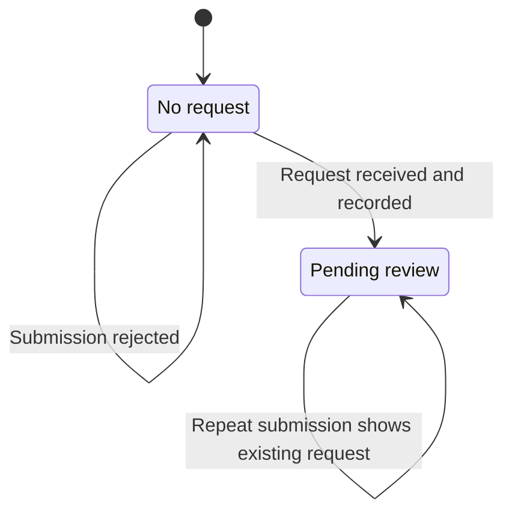

# Refund request lifecycle

This is the agreed lifecycle for the current refund request flow. Definitions live in [the glossary](../GLOSSARY.md).

| Current state | Event | Result | Customer feedback |
| --- | --- | --- | --- |
| No request | An eligible customer's valid request is recorded | Pending review | "Refund request received", followed by "Refund request pending review" |
| No request | Submission fails validation or eligibility checks | No request | An error, with no receipt confirmation |
| Pending review | The customer submits again | Same pending request, preserving its reason | Show the existing request |
| Pending review | The customer returns to the course or settings | Same pending request | "View refund request" on the course and "Refund request pending review" in settings |

Eligibility determines whether a customer can submit a new request. It is not a state of an existing request. "Refund request received" describes the event of recording a request. The request enters pending review immediately, so receipt and pending review are not successive stored states.

The amount requested is the original amount paid. Recording a request leaves course access intact. Approval and the return of money are separate milestones, and the current flow ends at pending review.

## Implementation boundary

The stored `requested` status corresponds to pending review. The schema also defines `approved` and `declined`, but the app has no implemented transitions to those states. Those names do not establish a complete review or payment lifecycle, and approval alone must not be presented as money returned.

Approval tools, payment processing, and email delivery are outside this change. The confirmation email template is logged rather than sent. Extending the lifecycle requires decisions about review outcomes, payment success and failure, and course access after resolution.
